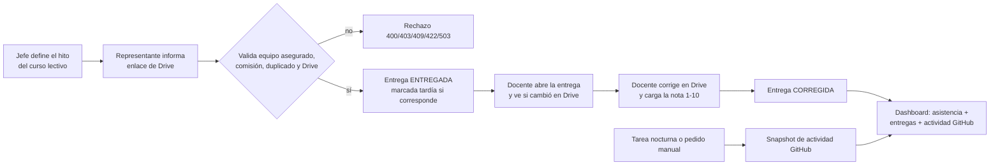

# 01 — Visión y alcance

## Problema
El Seminario Integrador exige que cada equipo desarrolle un proyecto de software y lo documente con informe inicial, entregas por sprint y documentos finales. No existe una visión confiable y unificada de cada equipo durante la cursada, por tres causas:
1. **Información dispersa:** la asistencia está en planillas, las entregas circulan como enlaces de Drive y la actividad vive en cada repositorio.
2. **Controles manuales:** un enlace puede estar roto o ser privado, y el documento puede cambiar después de entregado.
3. **Avance declarado, no evidenciado:** no hay datos que permitan contrastar lo que dice cada equipo.

Afecta a docentes (reúnen datos de varias fuentes), al jefe de cátedra (no tiene visión global) y a alumnos (no ven su situación).

## Solución
Atenas es un backend que centraliza la información de la cátedra, aplica las reglas del proceso de entregas y consolida el avance de cada equipo combinando datos propios con evidencia obtenida de **Google Drive** (existencia, tipo y fecha de modificación de los documentos) y **GitHub** (commits por sprint). No tiene interfaz gráfica: se usa por API.

## Actores
| Actor | Qué hace | Cómo se identifica |
|---|---|---|
| Jefe de cátedra | Administra cursos, comisiones, usuarios e hitos; consulta todos los equipos | Rol `JEFE_CATEDRA` (solo existe en Keycloak) |
| Docente | Gestiona equipos, calendario y asistencia de **sus** comisiones; corrige y califica | Rol `DOCENTE` + asignación a comisión |
| Alumno | Integra un equipo, carga su usuario de GitHub, consulta su asistencia y las entregas de su equipo | Rol `ALUMNO` |
| Representante | Alumno que asegura el equipo, vincula el repositorio y registra entregas | **No es un rol**: es un dato del equipo que valida `ms-catedra` |
| Sistema de tarea nocturna | Actualiza la actividad de GitHub | Cuenta de servicio, rol `SERVICIO` |

## Alcance del MVP (comprometido con la cátedra)
Estructura académica y usuarios · conformación de equipos · definición de hitos · registro y verificación de entregas en Drive · corrección y nota · calendario y asistencia · vinculación de repositorios · actividad por sprint · dashboard por equipo · acceso controlado por rol.

## Fuera de alcance
- Interfaz gráfica; gestión Scrum (backlog, tableros).
- Comentarios de corrección o anotaciones internas en el sistema; cálculo de la nota final de la materia.
- Carga masiva de usuarios; historial de recursado (cada estudiante tiene una única comisión vigente).
- Almacenar o leer el contenido de los archivos; reemplazar una entrega registrada; reintentos automáticos hacia Drive.
- GitHub: repositorios privados, más de una rama por equipo, webhooks, ETag.
- Notificaciones (correos o avisos): las advertencias se informan al consultar.
- Ciclo de vida del proyecto del equipo (en idea, en proceso, aprobado…): solo existen los estados `ABIERTO` y `ASEGURADO`.
- Circuit breaker, reintentos automáticos, logs centralizados.

## Proceso central
`hito → entrega verificada → corrección y nota → dashboard`

## Glosario
| Término | Significado |
|---|---|
| Curso lectivo | Marco temporal de un año de cursado |
| Comisión | Comisión permanente (ej. "3K7"), independiente del año |
| Comisión lectiva | Comisión dictada en un curso lectivo. Equipos, estudiantes y asignaciones docentes apuntan a ella |
| **Hito** | Instancia de entrega común a un curso lectivo, definida por el jefe (informe inicial, sprint o documento final), con ventana de fechas y fecha límite |
| Entrega | Lo que un equipo registra para un hito: un enlace de Drive verificado |
| Snapshot | Resultado guardado de consultar la actividad de GitHub de un equipo en un sprint |
| `sub` | Identificador único del usuario en Keycloak (claim del JWT) |
| Trusted zone | Red interna de Docker: solo Gateway y Keycloak publican puertos |
