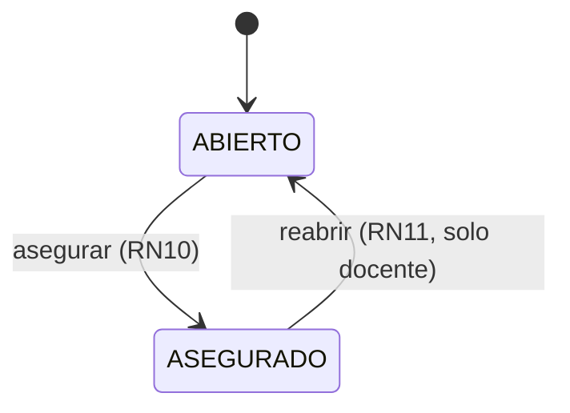

# 03 — Reglas de negocio y estados

Los IDs `RN` y `F` son los del cuestionario (RN01–RN33, F01–F16). **El alcance es exactamente ese.**
**Huecos de numeración:** RN04, RN14, RN16 y RN32 no existen en el cuestionario (no hay que implementarlos). Donde el cuestionario cita "RN-32" para el dashboard degradado, es **RN33**.
Marcas: **[ACLARADA]** el equipo precisó un punto que el cuestionario dejaba abierto o contradictorio; **[PROPUESTA]** supuesto a confirmar (detalle en `14`).

## Catálogo de reglas
| ID | Regla | Rechazos | F |
|---|---|---|---|
| RN01 | Solo el jefe administra estructura y usuarios. Cada docente opera y consulta solo sus comisiones | 403 | F02–F04, F08, F09, F12–F16 |
| RN02 **[ACLARADA]** | Alta de estudiante: legajo numérico y único. El mail institucional **se deriva**: `{legajo}@sistemas.frc.utn.edu.ar` (no se recibe) | 400, 409 | F03 |
| RN03 **[ACLARADA]** | Alta de usuario: guarda en la base y luego crea la cuenta en Keycloak (Admin API) con **clave temporal** y la acción obligatoria de cambiarla en el primer inicio. Si Keycloak falla, revierte | 503 | F03 |
| RN05 **[ACLARADA]** | Baja lógica: conserva el historial y deshabilita la cuenta; si Keycloak falla, revierte. Un estudiante con equipo **solo puede darse de baja si el equipo está `ABIERTO`** (un equipo asegurado impide cualquier salida); entonces cierra su participación y, si era representante, aplica RN09 | 404, 409, 503 | F03 |
| RN06 | Crear espacio de equipo: `cupoMinimo ≥ 1` y `cupoMinimo ≤ cupoMaximo`. El equipo nace `ABIERTO` | 400 | F04 |
| RN07 | Un alumno integra un solo equipo vigente en su comisión (garantizado por índice único parcial) | 409 | F04 |
| RN08 | Ingresar exige misma comisión, equipo `ABIERTO` y cupo disponible (`SELECT … FOR UPDATE` sobre el equipo) | 403, 409 | F04 |
| RN09 | El primer ingresante es representante y, con el equipo `ABIERTO`, puede rechazar ingresos. Si sale, lo reemplaza el integrante vigente más antiguo (desempate por id). Salir o rechazar con el equipo `ASEGURADO` no es posible | 403 si otro rechaza; 409 si está asegurado | F04 |
| RN10 **[ACLARADA]** | Asegurar (el equipo debe estar `ABIERTO`): un **docente de la comisión puede siempre**. Un **representante solo si** `cupoMinimo ≤ integrantes vigentes ≤ cupoMaximo` **y** todos cargaron su usuario de GitHub (condición del cuestionario, se mantiene) | 403, 409 | F04, F05 |
| RN11 | Reabrir: solo un docente de la comisión; el equipo vuelve a `ABIERTO`. Si después sale un integrante y queda bajo el mínimo, los alumnos ya no pueden asegurar (RN10): solo el docente | 403; 409 si ya está abierto | F04 |
| RN12 | Crear evento: solo docente asignado; tipo `CLASE` o `PRESENTACION` | 400, 403, 503 | F14 |
| RN13 | Asistencia: una por alumno y evento, de la misma comisión, sin fechas futuras; repetir actualiza | 403, 404, 409, 503 | F15 |
| RN15 | Un alumno solo ve su asistencia y las entregas de su equipo | 403, 503 | F08, F16 |
| RN17 | Crear hito: **solo el jefe**, con curso lectivo existente y fechas válidas (`fechaInicio < fechaLimite`, dentro del período del curso) | 400, 403, 404, 503 | F06 |
| RN18 | Registrar entrega: solo el representante de un equipo `ASEGURADO`, para un hito **de su curso** | 403, 409, 503 | F07 |
| RN19 | Validar enlace: archivo existente, accesible públicamente y de tipo PDF o Google Doc. Que el enlace permita comentar es una **instrucción operativa a los alumnos** (el sistema no lo verifica) | 400, 422 | F07 |
| RN20 | Estado de entrega: `PENDIENTE` se calcula si no hay fila; pasa a `ENTREGADA` al registrarla y a `CORREGIDA` al calificarla. No se corrige una pendiente | 404 si pendiente; 409 si ya corregida | F07, F08, F10 |
| RN21 | Entrega fuera de término: se acepta y se marca `tardia = true` | — | F07 |
| RN22 | Drive no responde al entregar: no registra; el equipo reintenta | 503 | F07 |
| RN23 | La corrección se hace en Drive; el sistema no gestiona comentarios | — | F09, F10 |
| RN24 **[ACLARADA]** | Corregir: solo docente de la comisión, sobre entrega `ENTREGADA`, nota **entera** de 1 a 10 | 403, 409, 422, 503 | F10 |
| RN25 | Vincular repositorio: solo el representante, repositorio público y rama existente | 403, 422, 503 | F11 |
| RN26 | Los commits se atribuyen a un integrante por su usuario de GitHub (en minúsculas); si no coincide, quedan sin atribuir | — | F05, F12 |
| RN27 **[ACLARADA]** | Actividad del sprint: commits de la rama elegida con fecha dentro de `[fechaInicio, fechaLimite]` del hito de tipo `SPRINT`; **los posteriores al límite no cuentan**; sin merges (commits con más de un padre); atribuidos por usuario. Marca "sin actividad" (0 commits del equipo) y "baja contribución" (integrante con menos del 50 % del promedio por integrante **[PROPUESTA: umbral configurable]**) solo de forma informativa | — | F12, F13 |
| RN28 | Si GitHub o un servicio interno no responde, se muestra el último snapshot como `DESACTUALIZADO` o la evidencia como `NO_DISPONIBLE` si no hay. Una respuesta inesperada de GitHub deja la evidencia `NO_DISPONIBLE`. Nunca bloquea | — | F12, F13 |
| RN29 | Ya existe entrega para ese hito y equipo: no se puede cambiar | 409 | F07 |
| RN30 | Al abrir una entrega se compara `modifiedTime` de Drive con la fecha de entrega y el límite; es informativo y **se congela al corregir**. Si Drive falla: `NO_VERIFICADO` | — | F09, F10 |
| RN31 | Actualizar actividad: de noche (cron, zona `America/Argentina/Cordoba`) o a pedido de docente/jefe; guarda un snapshot | 403 | F12 |
| RN33 | Si `ms-documentacion` no responde al armar el dashboard, se responde sin la sección de entregas marcada como no disponible | — | F13 |

## Estados del equipo

| Operación | `ABIERTO` | `ASEGURADO` |
|---|---|---|
| Ingresar (RN08) | Sí | 409 |
| Salir / rechazar ingreso (RN09) | Sí | 409 |
| Baja lógica de un integrante (RN05) | Sí | 409 |
| Asegurar (RN10) | Sí | 409 |
| Reabrir (RN11) | 409 | Sí |
| Registrar entrega (RN18) | 409 | Sí |

El estado se guarda en `equipo.estado` y su lógica se encapsula con el patrón State (ver `10`).

## Estados de la entrega
| Estado | Persistido | Cómo se llega | Quién |
|---|---|---|---|
| `PENDIENTE` | No (se calcula si no hay fila) | Existe el hito y no hay entrega del equipo | — |
| `ENTREGADA` | Sí | Registro validado | Representante |
| `CORREGIDA` | Sí | Carga de nota | Docente |

## Estados del snapshot de actividad
| Estado | Cuándo |
|---|---|
| `ACTUALIZADO` | Consulta exitosa a GitHub |
| `DESACTUALIZADO` | GitHub o un servicio interno no responde; conserva los datos del último snapshot |
| `NO_DISPONIBLE` | No hay datos previos y la consulta falla, o GitHub devuelve algo inesperado; contadores en `NULL` |
