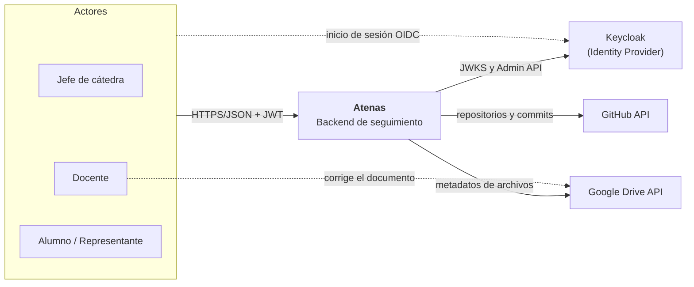
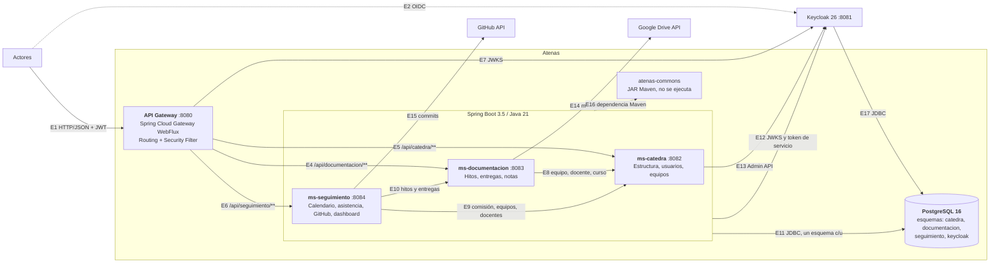

# 04 — Arquitectura

> Para entender el porqué: Apunte 1 (monolito vs microservicios), 19 (Gateway), 20 y 21-Seguridad (JWT, OIDC, Resource Server), 21-Docker y 22 (Compose). Las alternativas descartadas están en `adr.md`.

## C1 — Contexto

## C2 — Contenedores
Los puertos 8082–8084 son de desarrollo (IDE). Dentro de Docker todos los servicios escuchan en 8080 y **no publican puertos**.

Dependencias entre servicios (sin ciclos): `ms-seguimiento → ms-documentacion → ms-catedra` y `ms-seguimiento → ms-catedra`.

## Responsabilidad de cada pieza
| Pieza | Es dueña de | No hace |
|---|---|---|
| **api-gateway** | Enrutamiento por prefijo, validación de firma/emisor/vencimiento del JWT, autorización gruesa por método+ruta+rol, `X-Correlation-Id` | Reglas de negocio; exponer `/internal/**` |
| **ms-catedra** | Cursos, comisiones, docentes, estudiantes, equipos e integrantes; alta/baja de cuentas en Keycloak. **Fuente de verdad de personas y pertenencia** | Entregas, asistencia, GitHub |
| **ms-documentacion** | Hitos, entregas y su estado, verificación en Drive, corrección y nota | Saber quién pertenece a qué equipo (lo pregunta a `ms-catedra`) |
| **ms-seguimiento** | Calendario, asistencia, repositorio vinculado, snapshots de actividad, dashboard (compone datos de los otros dos) | Datos de personas o entregas (los consulta) |
| **atenas-commons** | Comportamiento técnico transversal (ver abajo) | Entidades, reglas de negocio, DTO de negocio |
| **Keycloak** | Credenciales, roles, emisión de JWT | Datos del dominio |

## Comunicación entre servicios
- HTTP/JSON síncrono con `RestClient` (Apunte 18). Cada servicio define su propio DTO de integración con solo los campos que usa.
- Las llamadas entre servicios usan rutas `/internal/**` (contratos en `06`) y **propagan el JWT del usuario** y el `X-Correlation-Id`. La tarea nocturna usa un token de servicio (Client Credentials).
- Toda llamada saliente tiene timeouts. Sin reintentos ni circuit breaker (fuera de alcance, ver ADR-004).
- Las llamadas externas se hacen **antes** de abrir la transacción local.

### Qué pasa cuando algo no responde
| Operación | Dependencia | Resultado |
|---|---|---|
| Registrar entrega | `ms-catedra`, Drive | 503, no registra |
| Crear hito | `ms-catedra` (curso y fechas) | 503 |
| Abrir entrega | `ms-catedra` / Drive | 503 / 200 con `NO_VERIFICADO` |
| Corregir | `ms-catedra` | 503 |
| Eventos y asistencia | `ms-catedra` | 503 |
| `mi-equipo/entregas`, `mi-asistencia` | `ms-catedra` | 503 |
| Dashboard | `ms-catedra` / `ms-documentacion` | 503 / 200 sin sección de entregas |
| Actualizar actividad | GitHub, otros servicios | Último snapshot `DESACTUALIZADO` o `NO_DISPONIBLE` |
| Alta / baja de usuario | Keycloak | 503 y revierte |

## Seguridad
**Autenticación:** OIDC con Keycloak (realm `atenas`, importado al iniciar Compose). JWT firmado; los servicios descargan las claves públicas (JWKS) y no consultan a Keycloak por cada pedido.

| Situación | Mecanismo | Cliente Keycloak | Identidad |
|---|---|---|---|
| Persona usa la API | Authorization Code | `atenas-postman` | Usuario con rol `JEFE_CATEDRA`, `DOCENTE` o `ALUMNO` |
| Llamada entre servicios por pedido de una persona | JWT del usuario propagado | — | La misma persona |
| Alta/baja de cuentas | Client Credentials | `atenas-catedra-admin` | Cuenta de servicio con `manage-users` |
| Tarea nocturna | Client Credentials | `atenas-seguimiento-job` | Cuenta de servicio con rol `SERVICIO` |

**Dos capas de autorización**
1. **Gateway:** firma, emisor (`iss`), vencimiento y rol permitido por método+ruta. Responde 401/403 sin que el pedido llegue al servicio.
2. **Servicio:** vuelve a validar el token, aplica el rol por endpoint en su `SecurityFilterChain` y las **reglas de dominio** (ser docente de la comisión, ser representante…), con 403 + `ProblemDetail`.

**Trusted zone:** solo el Gateway (8080) y Keycloak (8081) publican puertos. Servicios y PostgreSQL viven en la red interna de Docker. `/internal/**` no tiene ruta en el Gateway.

| Pedido | Responde | Resultado |
|---|---|---|
| Sin token, vencido o inválido | Gateway | 401 |
| Rol no permitido en la ruta | Gateway | 403 |
| Rol permitido, regla de dominio incumplida | Servicio | 403 `ProblemDetail` |
| `/internal/**` pedido al Gateway | Gateway | 404 (no hay ruta) |
| Conexión directa a un servicio desde afuera | — | Rechazada (sin puerto publicado) |
| Cuenta dada de baja con token vigente | Servicio | No pasa las validaciones contra `ms-catedra` |

Un JWT emitido no se revoca: vive hasta vencer (vida corta). Los secretos (clientes, base, token de GitHub, API key de Drive) llegan por variables de entorno desde `.env` (no versionado).

## Librería común `atenas-commons`
`ar.edu.utn.frc.atenas:atenas-commons:1.0.0`, JAR Maven instalado en `.m2` y declarado como dependencia en cada servicio.

| Se comparte (comportamiento técnico) | Queda en cada servicio |
|---|---|
| Excepciones base (400/403/404/409/422/503) y manejador global con `ProblemDetail` | Excepciones específicas (ej. entrega ya registrada) |
| Constantes de roles, conversor de JWT de Keycloak a authorities, utilidad para obtener el `sub` | `SecurityFilterChain` y permisos por endpoint |
| Configuración base de `RestClient` (timeouts), excepción técnica para fallas de conexión/5xx, interceptor que propaga JWT y correlation-id | Clientes concretos (Catedra, Drive, GitHub, Keycloak Admin) |
| Filtro de `X-Correlation-Id` → MDC | Decisión ante una falla externa (503 o degradar) |
| Utilidad de zona horaria | Entidades, repositorios, reglas, estados, DTO |

El Gateway **no** la usa (es reactivo: WebFlux). Duplica a mano roles y conversión de JWT; es una excepción documentada (ADR-006).
Los servicios la incluyen con `scanBasePackages` y ella declara Spring como `provided`.

## Despliegue (Docker Compose)
| Servicio | Imagen | Puertos publicados | Depende de (healthy) |
|---|---|---|---|
| `postgres` | `postgres:16` | ninguno (5432 solo con `docker-compose.dev.yml`) | — |
| `keycloak` | `quay.io/keycloak/keycloak:26.x` | 8081→8080 | `postgres` |
| `ms-catedra`, `ms-documentacion`, `ms-seguimiento` | `eclipse-temurin:21-jre` + JAR de `target/` | ninguno | `postgres`, `keycloak` |
| `api-gateway` | ídem | 8080 | los tres servicios, `keycloak` |

Configuración por perfil (`dev` desde el IDE, `docker` en Compose) y variables: ver `11-guia-de-desarrollo.md`.
