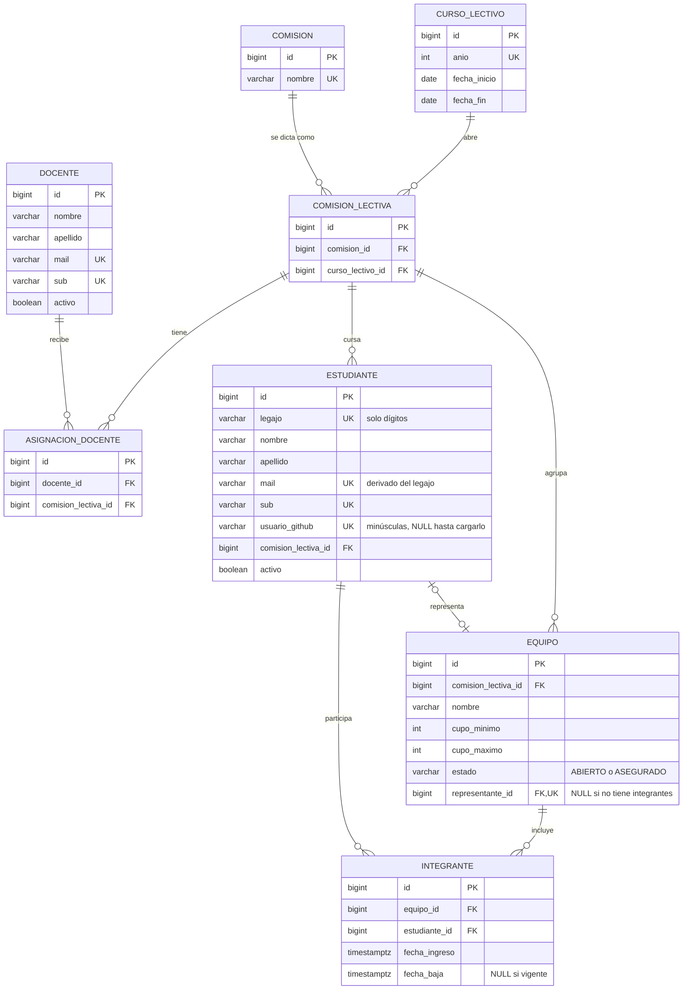
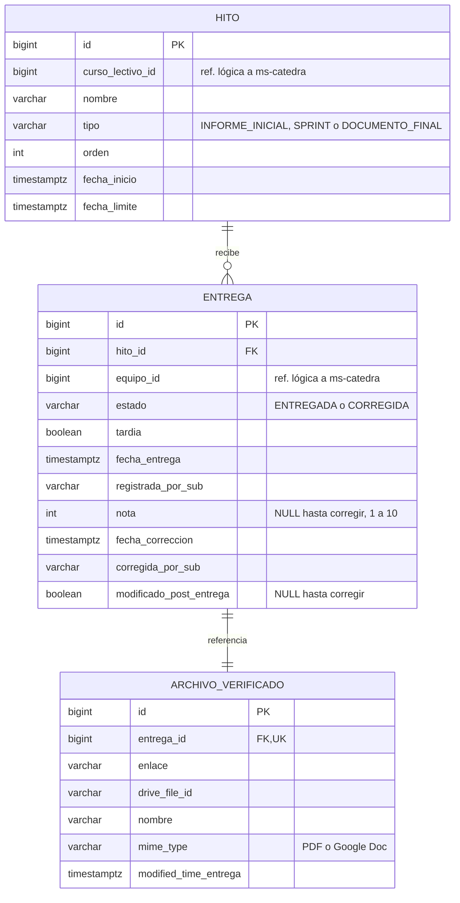
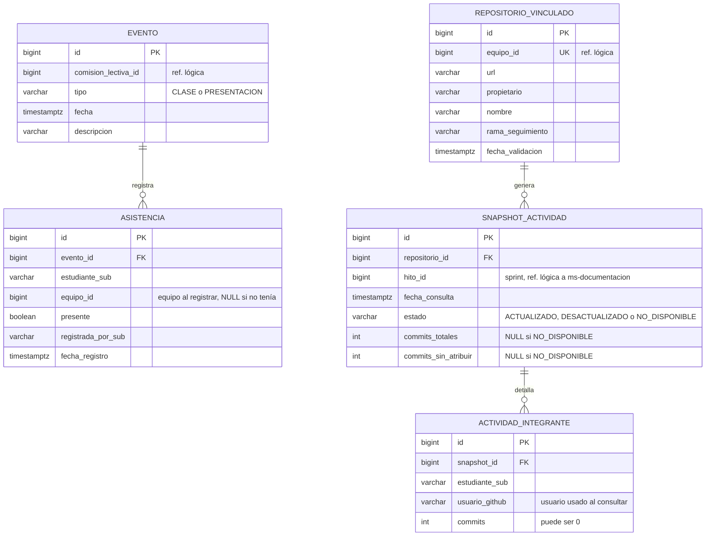

# 05 — Modelo de datos

> Para entender el porqué: Apunte 13 (JPA, `@ManyToOne` LAZY, evitar `@ManyToMany`, N+1) y Apunte 16 (Spring Data).

## Estrategia
- **Una instancia de PostgreSQL 16**, base `atenas`, con un **esquema y un usuario por servicio** (`catedra`, `documentacion`, `seguimiento`) más `keycloak`. Cada servicio solo accede a su esquema.
- **Sin claves foráneas entre esquemas.** Las referencias entre servicios son lógicas (`*_id`, `*_sub`) y se validan por API al escribir.
- IDs `BIGINT` autogenerados. Fechas en `timestamptz` (UTC) mapeadas a `Instant`.
- Hibernate genera las tablas (`ddl-auto=update`) con `hibernate.default_schema`. El índice único parcial de `INTEGRANTE` se crea con `data.sql` en `ms-catedra`.
- Sin contenido de archivos ni de commits: se guardan enlaces, metadatos y conteos.

## Esquema `catedra` (ms-catedra) — todas FK reales

Restricciones: `UNIQUE(anio)`; `fecha_fin > fecha_inicio`; `UNIQUE(comision_id, curso_lectivo_id)`; `UNIQUE(docente_id, comision_lectiva_id)`; `UNIQUE(comision_lectiva_id, nombre)` en equipo; `cupo_minimo ≥ 1 y ≤ cupo_maximo`; **índice único parcial** sobre `integrante(estudiante_id) WHERE fecha_baja IS NULL` (RN07).
`estado` ∈ `ABIERTO, ASEGURADO`.

Decisiones:
- `COMISION` (permanente) separada de `COMISION_LECTIVA` (su dictado en un año).
- Sin tabla para el jefe: existe solo en Keycloak.
- **Alta:** se inserta la fila, `flush` (detecta legajo/mail duplicados), se crea la cuenta en Keycloak, se completa `sub` y se confirma. Si Keycloak falla, se revierte. Riesgo aceptado: si falla el commit tras crear la cuenta, queda una cuenta huérfana en Keycloak.
- **Baja lógica** (`activo=false`) para no romper referencias lógicas de otros esquemas.
- **Historial de integrantes:** salir o ser rechazado completa `fecha_baja`; si vuelve, se crea una fila nueva.
- `representante_id` se guarda para consulta directa; lo calcula RN09 y el servicio garantiza que sea integrante vigente.
- Cupo: al ingresar se bloquea la fila del equipo con `SELECT … FOR UPDATE`.
- La base no verifica misma comisión ni cupo: lo hace el servicio (RN08).

## Esquema `documentacion` (ms-documentacion)

Restricciones: `UNIQUE(hito_id, equipo_id)` (impide duplicados aun con pedidos simultáneos → 409); nota entre 1 y 10; `fecha_inicio < fecha_limite`.
Decisiones: `curso_lectivo_id`, `equipo_id` y los `_sub` no tienen FK (pertenecen a `ms-catedra` y Keycloak) y se validan por la API interna. `PENDIENTE` **no se persiste** (se calcula al consultar, así los equipos nuevos no requieren sincronización). `modified_time_entrega` no se sobrescribe; la comparación se calcula al abrir y se congela en `modificado_post_entrega` al corregir (queda `NULL` si Drive falla en ese momento). `ENTREGA` y `ARCHIVO_VERIFICADO` se guardan juntas en **una transacción local**, después de consultar `ms-catedra` y Drive.

## Esquema `seguimiento` (ms-seguimiento)

Restricciones: `UNIQUE(evento_id, estudiante_sub)`; `UNIQUE(equipo_id)` en repositorio; `UNIQUE(snapshot_id, estudiante_sub)`; `commits ≥ 0`.
Decisiones: asistencia **una fila por alumno** (la carga por equipo se expande; repetir actualiza); sin fila = "no registrada", `presente=false` = ausencia registrada. Cada consulta exitosa crea un snapshot; el dashboard usa el más reciente por repositorio y sprint. Ante falla: el último pasa a `DESACTUALIZADO` conservando datos, o se crea uno `NO_DISPONIBLE`. Se guarda una fila por integrante incluso con 0 commits (distingue "sin actividad" de "sin datos"). Invariante: `commits_totales = Σ commits + commits_sin_atribuir`. Las marcas "sin actividad" y "baja contribución" **no se guardan**: se calculan al consultar.
