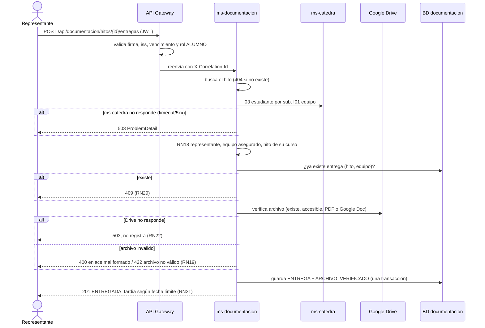
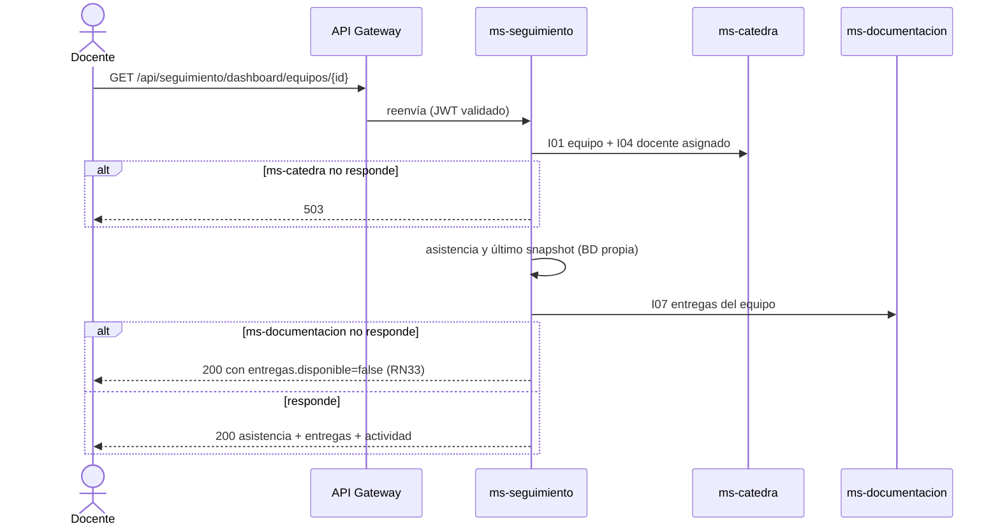
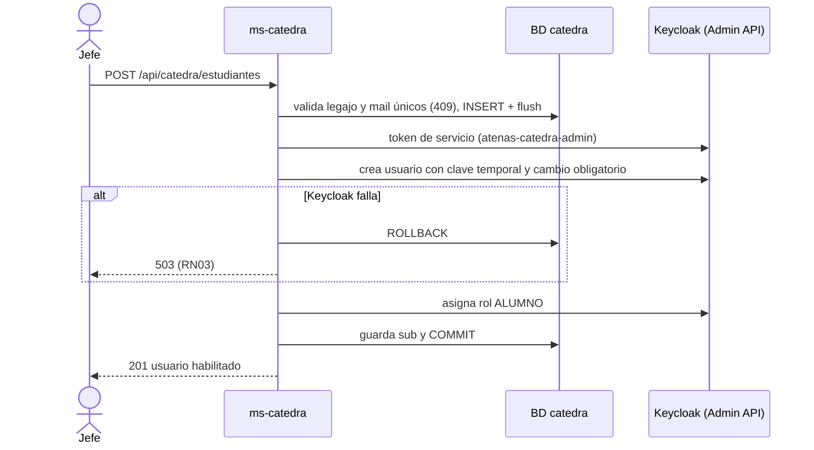
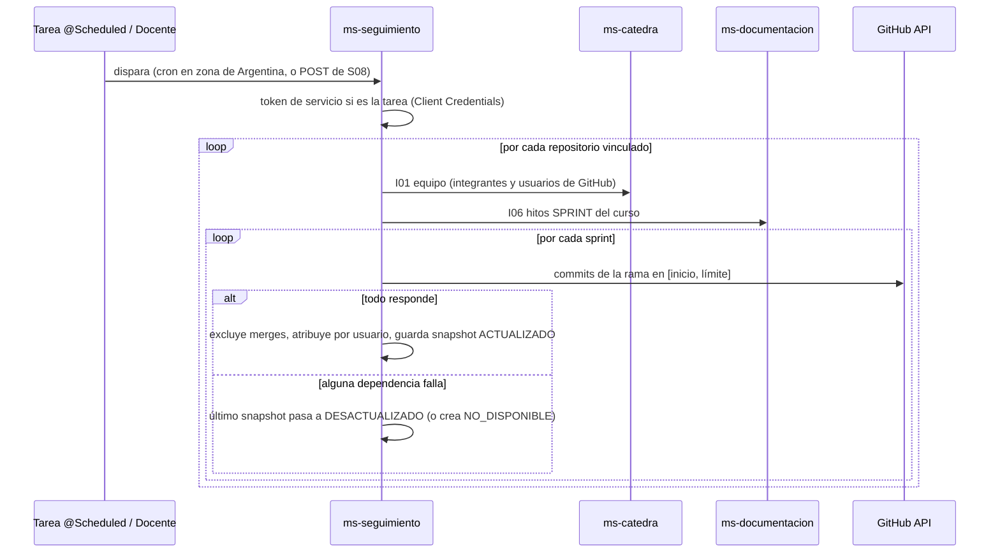

# 09 — Flujos principales

> Los números de regla (RN) están en `03`; los endpoints, en `06`.

## 1. Registrar una entrega (D03) — colaboración `ms-documentacion` ↔ `ms-catedra` + Drive

Las consultas a `ms-catedra` y Drive ocurren **antes** de la transacción. Si dos pedidos llegan a la vez, `UNIQUE(hito_id, equipo_id)` rechaza al segundo (409).

## 2. Dashboard con degradación (S10)

## 3. Alta de usuario con Keycloak (C07 / C11)

Riesgo aceptado: si el `COMMIT` falla después de crear la cuenta, queda una cuenta huérfana en Keycloak.

## 4. Actualización de actividad de GitHub (tarea nocturna o S08)

Una falla en un equipo no corta el procesamiento de los demás.
